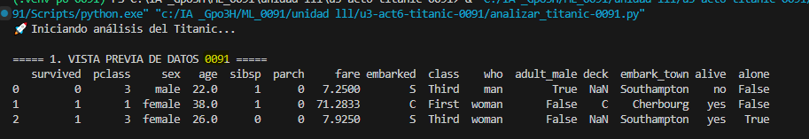
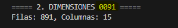
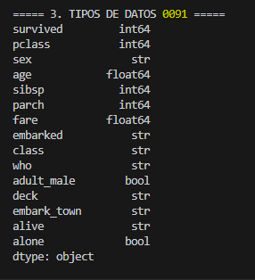
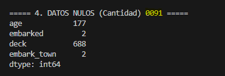
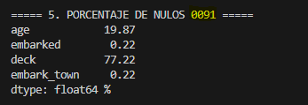
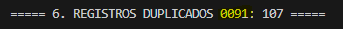
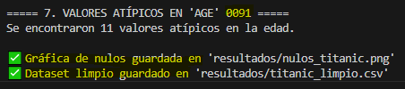
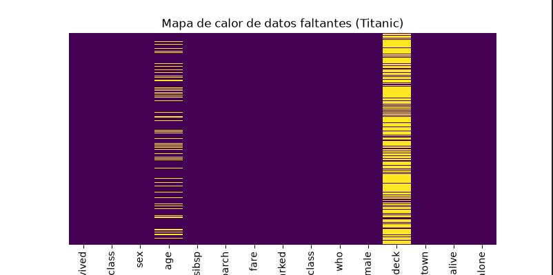

1. **Caso 1: Pasajeros del Titanic** 🚢 (Detección de problemas reales: nulos, duplicados, tipos y atípicos).

##  VISTA PREVIA DE DATOS

##  DIMENSIONES

##  TIPOS DE DATOS

##  DATOS NULOS (Cantidad) 

##  PORCENTAJE DE NULOS

##  REGISTROS DUPLICADOS

##  VALORES ATÍPICOS EN 'AGE'

## imagen generada 0091
